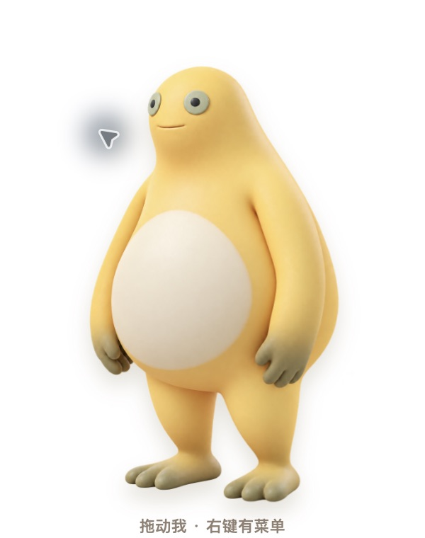

# 奶龙桌宠

一只住在桌面右下角、可以拖动和互动的透明桌宠。支持“奶龙”与“奶娃（奶蛙）”双形态，完全离线运行，不收集数据。

> 非官方、非商业粉丝项目。仓库没有直接打包网上下载的角色图片；项目内角色图为参考公开形象生成的 fan-art 素材。详细权利说明见 [NOTICE.md](NOTICE.md)。

## 实际运行预览

| 奶龙 | 奶娃 | 奶娃大笑 |
| --- | --- | --- |
|  |  |  |

## 功能

- 透明无边框窗口，默认置顶并停在屏幕右下角
- 紧凑的 `100×127` 逻辑像素窗口，角色、气泡与提示等比缩放
- 按住角色可拖到任意位置
- 单击奶龙：摸头、弹跳、爱心与随机回应
- 单击奶娃：捧腹狂笑、骤停收脸、上拳下掌与合成互动音效
- 双击：进入短暂午睡
- 右键：切换形态、置顶、开机启动、音效、归位与退出
- 支持多显示器边界保护与 `prefers-reduced-motion`

## 本地运行

需要 Node.js 20 或更高版本。

```bash
npm install
npm start
```

运行测试：

```bash
npm test
```

构建 macOS 安装包：

```bash
npm run dist:mac
```

未签名的本地构建首次打开时，macOS 可能提示来源未知。正式分发建议配置 Apple Developer ID 并完成公证。

## 操作速查

| 操作 | 效果 |
| --- | --- |
| 拖动 | 移动桌宠 |
| 单击 | 当前形态互动 |
| 双击 | 午睡 |
| 右键 | 打开设置菜单 |

## 技术说明

- Electron 主进程只负责透明窗口、系统菜单、位置约束与设置持久化。
- 渲染层通过隔离的 preload API 通信，关闭 Node.js 集成，并限制内容安全策略。
- 角色使用带透明通道的 3D PNG 精灵；奶娃互动时按节奏切换“捧腹大笑—突然收住—上拳下掌”三段姿态。
- 设置保存在 Electron 的用户数据目录，不会上传。

## 开源许可

程序代码使用 [MIT License](LICENSE)。角色名称与相关第三方权利不包含在许可授权范围内，请同时阅读 [NOTICE.md](NOTICE.md)。
